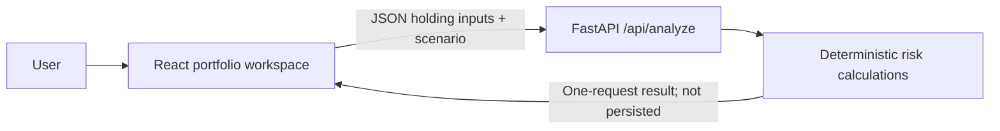

# Portfolio Lens

Portfolio Lens is a local-first portfolio risk analyzer. Add or upload holdings, look through user-supplied mutual-fund constituent weights, review sector/currency/asset-class exposure, and run an illustrative equity and USD/INR stress scenario. The React dashboard calls a FastAPI calculation endpoint.

> **Important:** This is an educational calculation tool, not personalized investment advice. It does not place trades, retrieve live prices, or claim to predict market returns.

## Start the application

Requirements: Python 3.11+ and Node.js 20.19+ (or 22.12+) with npm.

### 1. Start the API

From the repository root, in a terminal:

```powershell
python -m pip install -r institutional_predictor\requirements.txt
python -m uvicorn institutional_predictor.app:app --host 127.0.0.1 --port 8001
```

Interactive API documentation: <http://127.0.0.1:8001/docs>. `POST /api/analyze` accepts the portfolio and scenario and processes the request in memory.

### 2. Start the frontend

In another terminal:

```powershell
cd frontend
npm ci
npm run dev
```

Open <http://127.0.0.1:5173>. Vite proxies `/api` requests to the API on port 8001. Use **Load demo** to inspect the workflow; those prices and example mutual-fund constituents are illustrative, not current market data or real fund disclosures.

## Portfolio JSON

Provide a JSON array. Direct holdings use quantity and price; mutual-fund `price` is the INR NAV and `quantity` is the number of units. Add `constituents` as fractional weights (0 to 1) of the INR NAV for look-through sector, currency, overlap, and stress calculations. Constituent values remain in INR; their currency tag affects FX exposure but does not convert the already INR-valued fund NAV again. Constituents not listed are reported as `Other` rather than assumed to be a known sector or asset.

```json
[
  {
    "type": "equity",
    "symbol": "TCS",
    "quantity": 10,
    "price": 3000,
    "currency": "INR",
    "sector": "Information Technology",
    "source_url": "https://example.org/holding-source"
  },
  {
    "type": "mf",
    "symbol": "Example Fund",
    "quantity": 200,
    "price": 50,
    "constituents": [
      { "symbol": "TCS", "weight": 0.15, "sector": "Information Technology" },
      { "symbol": "HDFC Bank", "weight": 0.10, "sector": "Banking" }
    ]
  },
  {
    "type": "us_stock",
    "symbol": "AAPL",
    "quantity": 5,
    "price": 150,
    "currency": "USD",
    "sector": "Technology"
  }
]
```

Types: `equity`, `mf`, `us_stock`, `etf`, and `debt`. Optional fields include `asset_class` (`Equity`, `Debt`, or `Other`), mutual-fund `amc`/`scheme_code`, and `source_url` (HTTP/HTTPS only). The analysis request also accepts `scenario` fields `equityShockPercent` and `usdInrChange`, plus `usd_inr_rate` (INR per USD). The frontend defaults to an explicitly user-editable rate of 83.5; it is not a live quote.

## Analysis and sources

- Exposure percentages are normalized to 100% across each allocation view.
- A fund overlap is reported only when the same constituent appears in at least two supplied funds. Its weights are relative to the total portfolio value.
- Equity shock applies to equity-class exposures. Currency shock applies to USD exposures and includes the equity/FX interaction.
- The deterministic explanation is generated from the calculated figures. Source links are shown only when supplied by the user; no external evidence is fabricated.
- The API does not persist the submitted portfolio. The legacy SEC tracker tables/endpoints are not used by the active portfolio analysis workflow.
- This MVP does not fetch AMFI/CAMS constituents, prices, RBI FX rates, or external research. It has no AI/LLM, ML alerts, user accounts, or Account Aggregator connection.

## Validate

```powershell
python -m pytest institutional_predictor\tests -q
cd frontend
npm test
npm run build
```

## Architecture


