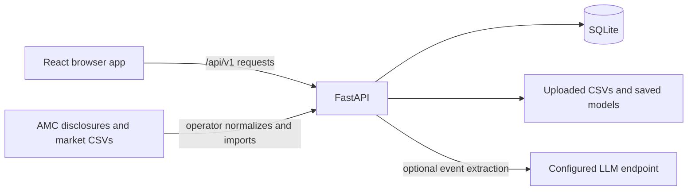

# How Riskora works

Riskora is a research workspace for comparing dated mutual fund portfolio disclosures. It can rank stocks that may **newly appear in a later valid disclosure**. A holding statement shows a position at a report date; it does not show when or why a trade happened. Ranking scores are not calibrated probabilities.

## What you see in the site

| Screen | What it does |
| --- | --- |
| **Overview** | Shows fund and disclosure coverage, the latest import, and data warnings. |
| **Fund explorer** | Shows a fund's dated snapshots, holdings, and changes between disclosures. |
| **Evaluation** | Checks whether enough comparable history exists, trains a model when eligible, and shows later-period results. |
| **Predictions** | Ranks known stocks absent from the selected complete disclosure, using a saved current model. |
| **Evidence** | Explains a selected ranking with its dated inputs and source information. |
| **Data management** | Imports holdings and market CSVs, reviews identifiers, records company events, and loads a fictional sample. |

The page navigation is handled in the browser with URL hashes. Refreshing a screen fetches current data from the API; the browser does not run the model itself.

## Request and data flow

- `frontend/src/main.tsx` mounts `Stage.tsx` and `App.tsx`. Pages are in `frontend/src/pages/`; `frontend/src/hooks/useResearch.ts` coordinates requests and actions; `frontend/src/api.ts` sends them to `/api/v1`.
- `backend/app/main.py` defines the API and management-token check. `db.py` owns SQLite setup; `ingestion.py` validates imports; `ml.py` builds labels, features, evaluations, and rankings; `signals.py` handles optional event extraction.
- The browser stores the management token only in the current tab's React state. It sends the token as `X-Admin-Token` for protected write actions. Read endpoints do not require it.

During local development, Vite serves the frontend on port 5173 and proxies `/api` to FastAPI on port 8001. In a live deployment, a web server serves `frontend/dist` and sends `/api/*` to FastAPI. See [hosting Riskora live](hosting-live.md).

## Where the data comes from

Riskora starts with an empty local database. The repository contains two kinds of example input:

1. **Supplied ABSL Flexi Cap disclosures:** August and September 2026 AMC workbooks and normalized holdings CSVs in `data/absl_flexi_cap/`. Run `python scripts/load_supplied_disclosures.py` from the repository root to validate and load them. Their exact public release dates are unverified, so the site marks them **Observed** and excludes them from model labels. See the [data review](absl-data-review.md).
2. **Synthetic sample:** **Data management → Load synthetic sample** creates fictional funds, snapshots, and market observations. It exercises the complete model workflow but says nothing about real-market performance.

For your own data, import one normalized holdings CSV per fund and report date, with a source URL and actual publication date. The statement must be complete and comparable before an absent stock can count as a verified negative. Optional market CSVs add price, return, and volume inputs. The [root README](../README.md#import-real-disclosures) gives the columns and checks. Acquisition scripts and source manifests are described in [ABSL data acquisition](absl-data-acquisition.md); downloaded files are not imported automatically.

## How a ranking becomes available

1. The backend pairs eligible monthly or quarterly disclosures for the same fund. It uses only information available by each cutoff date.
2. A stock absent from an earlier **complete** statement and present in the next complete statement at or above the materiality threshold is a new disclosed position. Missing or incomparable statements produce unknown cases, not negative labels. An increase in units of an existing holding is recorded separately as accumulation.
3. **Evaluation** requires at least four comparable cutoff periods and both positive and negative training cases. It fits on earlier periods, evaluates later periods, and holds the final cutoff out. Saved runs include metrics such as precision@5, recall@5, and average precision.
4. **Predictions** uses a current `logistic-v2` run for the selected data class and period. It ranks securities already known by the cutoff and absent from the latest complete statement. Selecting a company opens its supporting signals in **Evidence**.

The supplied ABSL snapshots alone cannot train the model. Load the synthetic sample to see a working evaluation and ranking, or collect more verified historical disclosures and point-in-time market observations for a real-data study. A trained run is saved in SQLite and as a model file beside the database.

## Management and optional extraction

Set `RISKORA_ADMIN_TOKEN` in the backend environment to enable imports, synthetic loading, identifier edits, events, and training. Enter it in **Data management** or **Evaluation** when performing an action. Do not share it with visitors. Public readers can inspect already loaded data without the token.

Company events can be stored without an LLM. Extraction only runs when `LLM_BASE_URL`, `LLM_API_KEY`, and `LLM_MODEL` are configured on the server. Its facts must be grounded in the supplied excerpt; the original event remains separate from extracted content.

## Run it locally

Follow [Start locally](../README.md#start-locally) for the backend and frontend commands. Open `http://127.0.0.1:5173`; FastAPI's interactive reference is at `http://127.0.0.1:8001/docs`.
